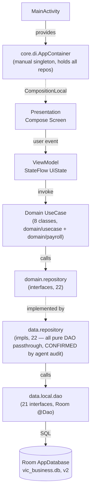
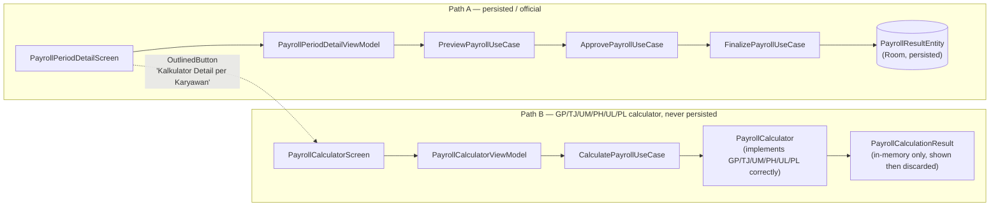

# ARCHITECTURE_AUDIT.md — MyPayroll

- **Audit date:** 12-10-2026
- **Audit type:** Read-only reverse audit. No source/config file was modified to produce this document.
- **Scope:** Full `app/src/main/java/com/mypayroll` tree, Gradle config, manifest, Room schema/migrations.
- **Confidence labeling used throughout:** `CONFIRMED FROM CODE` (read the file directly), `CONFIRMED BY BUILD/TEST` (a command was actually run), `INFERRED` (reasonable deduction, not directly observed), `UNKNOWN / NEEDS USER CONFIRMATION`. No `OBSERVED AT RUNTIME` claims appear anywhere in this document — the app was never launched on a device/emulator during this audit.

---

## 1. Project / module / package map

**CONFIRMED FROM CODE** (`app/build.gradle.kts`, `settings.gradle.kts`, `gradle/libs.versions.toml`, `app/src/main/AndroidManifest.xml`):

- Gradle root project name: `Payroll`. Single module: `:app`.
- `applicationId` / `namespace`: `com.mypayroll`. `minSdk=26`, `targetSdk=37`, `compileSdk=37`. `versionCode=1`, `versionName="1.0"`.
- Kotlin `2.2.10`, AGP `9.4.1`, KSP `2.3.6`, Compose BOM `2026.02.01`, Room `2.8.5`, Navigation Compose `2.9.3`, Lifecycle `2.8.7`, Activity Compose `1.10.1`.
- No Hilt/Koin/Dagger dependency anywhere in `libs.versions.toml` or `app/build.gradle.kts` — DI is a hand-written singleton container (`core/di/AppContainer.kt`).
- `sourceCompatibility`/`targetCompatibility` = Java 11.
- Manifest: single `MainActivity` (exported, `MAIN`/`LAUNCHER`), no other activities/services/receivers, no permissions declared.
- **Not a git repository** — `git status` at the project root returns `fatal: not a git repository`. There is no commit history anywhere; `mod-*.md` reports (introduced in this session) are currently the only change trail.

File counts per package (`find ... | sed ... | sort | uniq -c`, **CONFIRMED FROM CODE**):

| Package | Files |
|---|---|
| `data/local/entity` | 23 |
| `domain/repository` | 22 |
| `data/repository` | 22 |
| `data/local/dao` | 21 |
| `domain/usecase` | 8 |
| `presentation/payroll` | 6 |
| `presentation/employee` | 6 |
| `domain/model` | 5 |
| `presentation/organization` | 4 |
| `presentation/compensation` | 4 |
| `domain/payroll` | 4 |
| `presentation/attendance` | 3 |
| `presentation/reference`, `presentation/payrollsetup`, `presentation/overtime`, `presentation/navigation`, `presentation/leave`, `presentation/document`, `presentation/discipline`, `presentation/dashboard`, `data/local`, `core/di` | 2 each |
| `presentation/theme`, `presentation/more`, `presentation/common`, `data/local/converter`, `core/format` | 1 each |
| `MainActivity.kt` | 1 |

## 2. Layered architecture (as-built)

**CONFIRMED FROM CODE.** The app follows a conventional 5-layer structure with one manual DI container; no layer is skipped structurally, though two call-sites bypass the use-case layer (noted in §7).

- **Presentation:** Jetpack Compose screens under `presentation/<feature>/`, each typically paired 1:1 with a `ViewModel` exposing a `StateFlow<XxxUiState>`. `androidx.lifecycle.viewModelScope` + `kotlinx.coroutines.flow` (`combine`, `stateIn`, `.catch`) is the consistent reactive pattern across every feature examined (Dashboard, Employee, Attendance, Leave, Overtime, Organization, Document, Discipline, MasterData, Payroll, Payroll Setup).
- **Domain — usecase:** 8 classes in `domain/usecase/` (`GetDashboardSummaryUseCase`, `ObserveEmployeesUseCase`, `SaveEmployeeUseCase`, `DeleteEmployeeUseCase`, `ObserveEmployeeProfileUseCase`, `PreviewPayrollUseCase`, `ApprovePayrollUseCase`, `FinalizePayrollUseCase`) + a separate `domain/payroll/` sub-package (`PayrollCalculator`, `CalculatePayrollUseCase`, `PayrollCalculationInput`, `PayrollCalculationResult`) that is **architecturally and behaviorally independent** of the `domain/usecase` payroll pipeline (see §6, this is the single most important finding of this audit).
- **Domain — repository interfaces:** 22 interfaces in `domain/repository/`, each a thin CRUD/Flow contract (`observeAll`, `getById`, `insert`, `update`, `delete`, usually `observeByEmployee`).
- **Data — repository impls:** 22 impls in `data/repository/`, **every one of them is a pure 1:1 delegation to its DAO** (`CONFIRMED FROM CODE` by direct audit of all 20 non-Payroll-Setup pairs plus the 2 already read directly: `PayComponentRepositoryImpl`, `PayrollSetupRepositoryImpl`). No mapping, no business logic, no transactions, no error handling beyond what Room itself throws, anywhere in this layer.
- **Data — DAO / Room:** 21 `@Dao` interfaces, 21 (`AppDatabase` lists 21 entities, one of which — `PayrollSetupConfig` — intentionally has none, see §4) `@Entity` classes, 1 `AppDatabase` (version 2), 1 migration (`MIGRATION_1_2`), 1 `RoomConverters` (`LocalDate`/`LocalDateTime`/`LocalTime` ↔ String, plus one converter per enum).
- **DI:** `core/di/AppContainer.kt` — a hand-written singleton (`getInstance(context)`), constructed once in `MainActivity.onCreate`, exposed to the whole Compose tree via `LocalAppContainer` (`staticCompositionLocalOf`, errors loudly if unprovided). Every ViewModel across the app is instantiated manually inside a `remember { ... }` block in its owning Composable, reading repositories off `LocalAppContainer.current` — there is no ViewModel factory/SavedStateHandle wiring, so ViewModel state does not survive process death (only configuration change, via normal `remember`/`ViewModel` retention).
- **Navigation:** single `NavHost` in `presentation/navigation/AppNavGraph.kt`, driven by `presentation/navigation/Routes.kt` route constants. One bottom nav bar (Dashboard/Karyawan/Absensi/Payroll/Lainnya) + a "Lainnya" (More) list screen for secondary features. No second NavHost exists anywhere (verified: only one `rememberNavController()` call in the codebase, in `AppNavGraph.kt`).

## 3. Entry point

**CONFIRMED FROM CODE** (`MainActivity.kt`): `onCreate` builds `AppContainer.getInstance(applicationContext)`, calls `setContent { CompositionLocalProvider(LocalAppContainer provides container) { MyPayrollTheme { Surface(...) { AppNavGraph() } } } }`. No splash screen, no login/auth gate — the app opens directly on `Routes.DASHBOARD`. `MyPayrollTheme` (`presentation/theme/Theme.kt`) follows system light/dark (`isSystemInDarkTheme()`) and uses Android 12+ dynamic color with a static fallback palette on older devices.

## 4. Database schema summary (Room, v2)

**CONFIRMED FROM CODE** (`AppDatabase.kt`, `Migrations.kt`, entity files, cross-checked by a dedicated sub-agent read of every remaining entity/DAO).

- DB file name: `vic_business.db`. `@Database(version = 2, exportSchema = true)`.
- **`exportSchema = true` is currently a no-op**: no `schemas/` directory exists anywhere in the repo, and `app/build.gradle.kts` sets no `room.schemaLocation` KSP argument — Room has nowhere to write the schema JSON. This means there is no machine-checkable schema history to diff against for future migrations; a developer writing `MIGRATION_2_3` would have no generated v1/v2 JSON to verify against. **Technical debt.**
- Builder: `Room.databaseBuilder(context, AppDatabase::class.java, "vic_business.db").addMigrations(MIGRATION_1_2).build()` — **no `.fallbackToDestructiveMigration()`**. This is a deliberate safety choice: a future schema change without a matching migration will make the app **crash on open** rather than silently wipe user data. Good for data-integrity, but means every future entity change *must* ship a migration or the app becomes unusable until one is added.
- `MIGRATION_1_2` (the only migration that exists) **only adds three new tables** — `payroll_period`, `payroll_result`, `payroll_approval` — and touches no pre-existing table (`CONFIRMED FROM CODE`, `Migrations.kt`). This means the v1 schema (everything except those 3 tables) has never been migration-tested beyond its original creation.
- 21 entities are registered in `@Database(entities = [...])` (full list: Attendance, AttendanceException, ContractType, Department, Document, EmployeeContract, EmployeeDisciplinaryAction, Employee, EmployeeIncentive, EmployeePayComponentHistory, EmployeePositionHistory, EmployeeSalaryHistory, LeaveRequest, LeaveType, OvertimeAssignment, OvertimeRecord, PayComponent, Position, PayrollPeriod, PayrollResult, PayrollApproval).
- **`PayrollSetupConfig` (added this session, see `mod-121026-1.md`) is deliberately NOT a Room entity** — it is a single global-settings row stored in `SharedPreferences` via `PayrollSetupRepositoryImpl`, specifically to avoid touching the immutable `data.local.dao`/`data.local.entity` packages. This is correctly outside the Room schema by design, not an oversight.

### 4.1 Entity inventory (compact)

| Entity (table) | PK | FK → (onDelete) | Notable fields |
|---|---|---|---|
| `EmployeeEntity` (`employee`) | id | — | nik(unique), name, birthDate?, gender?, joinDate, resignDate?, status. **No level/grade/manager field.** |
| `PositionEntity` (`position`) | id | — | code(unique), name, active. **No level/category field.** |
| `DepartmentEntity` (`department`) | id | — | code(unique), active |
| `EmployeePositionHistoryEntity` (`employee_position_history`) | id | employeeId→employee(CASCADE); positionId→position(RESTRICT); departmentId→department(RESTRICT); supervisorId→employee(SET_NULL) | startDate/endDate, supervisorId (who supervises, not a level flag) |
| `EmployeeContractEntity` (`employee_contract`) | id | employeeId→employee(CASCADE); contractTypeId→contract_type(RESTRICT); documentId→document(SET_NULL) | contractNumber(unique), status:ContractStatus |
| `ContractTypeEntity` (`contract_type`) | id | — | code(unique), name |
| `EmployeeSalaryHistoryEntity` (`employee_salary_history`) | id | employeeId→employee(CASCADE) | effectiveDate, basicSalary:Long, salaryType:SalaryType |
| `PayComponentEntity` (`pay_component`) | id | — | code(unique), category:PayComponentCategory, calculationType:CalculationType, taxable, bpjsApplicable. **No amount field — metadata only.** |
| `EmployeePayComponentHistoryEntity` (`employee_pay_component_history`) | id | employeeId→employee(CASCADE); payComponentId→pay_component(RESTRICT) | effectiveDate, endDate?, amount:Long, calculationType |
| `EmployeeIncentiveEntity` (`employee_incentive`) | id | employeeId→employee(CASCADE); payComponentId→pay_component(RESTRICT) | date, amount:Long (fixed, no formula field) |
| `AttendanceEntity` (`attendance`) | id | employeeId→employee(CASCADE) | unique(employeeId,workDate); workDate, scheduled/actual In/Out:LocalTime?, status:AttendanceStatus, lateMinutes:Int=0, earlyLeaveMinutes:Int=0. **No "scheduled work days (period)" concept — per-day only.** |
| `AttendanceExceptionEntity` (`attendance_exception`) | id | employeeId→employee(CASCADE) | date, type:AttendanceExceptionType, status:ApprovalStatus |
| `LeaveRequestEntity` (`leave_request`) | id | employeeId→employee(CASCADE); leaveTypeId→leave_type(RESTRICT) | startDate/endDate, status:ApprovalStatus. **No day-count/quota field.** |
| `LeaveTypeEntity` (`leave_type`) | id | — | code(unique), active. **No quota/days field.** |
| `OvertimeAssignmentEntity` (`overtime_assignment`) | id | employeeId→employee(CASCADE) | workDate, plannedStart/End:LocalTime, status:OvertimeAssignmentStatus |
| `OvertimeRecordEntity` (`overtime_record`) | id | assignmentId→overtime_assignment(CASCADE) | actualStart/End:LocalTime, approvedMinutes:Int=0, **calculationAmount:Long=0 (flat, caller-supplied — no formula in Entity/DAO/Repository)**, status:OvertimeRecordStatus |
| `EmployeeDisciplinaryActionEntity` (`employee_disciplinary_action`) | id | employeeId→employee(CASCADE) | incidentDate/actionDate, actionType:DisciplinaryActionType(enum), category:String?, description. **No monetary field anywhere.** |
| `DocumentEntity` (`document`) | id | — | documentType, createdAt. `storagePath` is a free-text string; no SAF/file-picker wiring (metadata only, self-disclosed in UI) |
| `PayrollPeriodEntity` (`payroll_period`) | id | — | code(unique), startDate/endDate, status:PayrollPeriodStatus, finalizedAt?/finalizedBy? |
| `PayrollResultEntity` (`payroll_result`) | id | payrollPeriodId→payroll_period(CASCADE); employeeId→employee(RESTRICT) | unique(payrollPeriodId,employeeId); basicSalary, totalAllowance, totalIncentive, totalOvertimeAmount, attendanceDeduction, totalDeduction, grossPay, netPay, status:PayrollResultStatus. **No UM/PH/UL/PL columns — see §6.** |
| `PayrollApprovalEntity` (`payroll_approval`) | id | payrollPeriodId→payroll_period(CASCADE) | action:PayrollApprovalAction, actedBy?, actedAt (audit trail of approve/finalize events) |

Every `grep -rniE "manager|supervisor|level|grade"` hit across every entity file resolves to either `PayComponentCategory` (a pay-component classification, unrelated to employees), a free-text `category:String?` on disciplinary actions, or `supervisorId` (an org-chart pointer, not a manager/non-manager flag). **There is no persisted Manager/Non-Manager (or any job-level) attribute anywhere in the schema.** (`CONFIRMED FROM CODE` by dedicated sub-agent grep + direct reads of `EmployeeEntity.kt`, `PositionEntity.kt`.)

### 4.2 DAO inventory

All 21 DAOs follow one shape: `getById(id): Entity?` (suspend), `observeAll()`/`observeByEmployee(id)`: `Flow<List<Entity>>`, `insert`/`insertAll` (`@Insert(OnConflictStrategy.ABORT)`, suspend, returns `Long`/`List<Long>`), `update`/`delete` (`@Update`/`@Delete`, suspend). Deviations worth noting (`CONFIRMED FROM CODE`):
- `EmployeeDao.getByNik(nik)`, `AttendanceDao.getByEmployeeAndDate(employeeId,date)`, `PayrollPeriodDao.getByCode(code)`, `PayrollResultDao.getByPeriodAndEmployee(periodId,employeeId)` — the only non-generic lookup queries in the whole DAL.
- `PayrollApprovalDao` has **no `@Update` method** (only insert/delete/get/observe) — approvals are append-only by design, consistent with it being an audit trail.
- No DAO anywhere performs a SQL `JOIN` — every "joined" view in the app (e.g. `EmployeeProfile`, `PayrollLineItem`) is assembled **in-memory** in a UseCase from multiple `observeAll()`/`observeByEmployee()` Flows (`ObserveEmployeeProfileUseCase.kt:21-24`, `PreviewPayrollUseCase.kt`). This is a deliberate, documented tradeoff (comments confirm it), not an oversight, but it means every "profile"/"preview" screen loads the *entire* table for several entities into memory and filters client-side — fine at small data volumes, a scalability risk at large employee counts.

### 4.3 Repository inventory

22 interface/impl pairs, **every single one is a pure passthrough** (`CONFIRMED FROM CODE`, sub-agent read all 20 remaining pairs after I had already read `PayComponentRepository`/`Impl` and `PayrollSetupRepository`/`Impl` directly). No repository in this codebase does mapping, aggregation, caching, or transactional multi-table writes — all of that logic lives one layer up, in `domain/usecase/`. `PayrollResultRepository.insertAll` is a straight `dao.insertAll(entities)` with no per-item logic despite the name suggesting a bulk operation worth special-casing.

## 5. Domain / UseCase inventory

**CONFIRMED FROM CODE** (all 8 `domain/usecase/*.kt` files + `domain/payroll/*.kt` read directly):

| UseCase | Depends on | Purpose |
|---|---|---|
| `ObserveEmployeesUseCase` | `EmployeeRepository` | 1-line passthrough to `observeAll()` |
| `SaveEmployeeUseCase` | `EmployeeRepository` | insert if `id==0L` else update |
| `DeleteEmployeeUseCase` | `EmployeeRepository` | passthrough to `delete()` |
| `ObserveEmployeeProfileUseCase` | Employee/PositionHistory/Contract/SalaryHistory/Department/Position repos | in-memory join → `EmployeeProfile` (current position/department/contract/salary) |
| `GetDashboardSummaryUseCase` | Employee/Attendance/LeaveRequest/EmployeeContract/OvertimeAssignment/OvertimeRecord/PayrollPeriod repos | in-memory aggregation → `DashboardSummary`, all real data, explicitly documented as never-fabricated |
| `PreviewPayrollUseCase` | Employee/SalaryHistory/PayComponentHistory/Incentive/OvertimeAssignment/OvertimeRecord/Attendance repos | computes the **persisted** payroll line items — see §6, this formula does **not** implement GP/TJ/UM/PH/UL/PL |
| `ApprovePayrollUseCase` | PayrollResult/PayrollPeriod/PayrollApproval repos | persists `PreviewPayrollUseCase` output as `PayrollResultEntity` rows, flips period to APPROVED, refuses if already FINALIZED |
| `FinalizePayrollUseCase` | same 3 repos | flips all period results + the period itself to FINALIZED, refuses unless APPROVED |
| `CalculatePayrollUseCase` (`domain/payroll/`) | none (pure function, wraps `PayrollCalculator`) | computes GP/TJ/UM/PH/UL/PL correctly per spec — **never called by any Approve/Finalize flow**, only by the standalone, non-persisting `PayrollCalculatorScreen` |

`domain/model/` (5 files): `PayrollLineItem` (computed `totalDeduction`/`grossPay`/`netPay` properties, feeds the persisted path), `PayrollPolicy` (BPJS/tax/late/absent rates, explicit `DISCLAIMER` constant stating these are unconfirmed official rules, default 0), `DashboardSummary`, `EmployeeProfile`, `PayrollSetupConfig` (added this session).

## 6. THE CENTRAL FINDING: two disconnected payroll calculation paths

**CONFIRMED FROM CODE.** This is the single most consequential architectural fact in the codebase and drives most of `GAP_ANALYSIS.md`.

- **Path A** (`PreviewPayrollUseCase` → `ApprovePayrollUseCase` → `FinalizePayrollUseCase` → `PayrollResultEntity`) is what actually gets saved to the database and is what a user would call "the real payroll." Its formula (`PreviewPayrollUseCase.kt:43-91`):
  - `basicSalary` = latest `EmployeeSalaryHistoryEntity.basicSalary` effective on/before period end — **flat, never prorated, no Manager/Non-Manager branch at all.**
  - `totalAllowance` = sum of `EmployeePayComponentHistoryEntity.amount` active during the period — a flat sum of whatever generic pay components exist, not specifically TJ/UM/PH.
  - `totalIncentive` = sum of `EmployeeIncentiveEntity.amount` dated in period.
  - `totalOvertimeAmount` = sum of `OvertimeRecordEntity.calculationAmount` for approved records in period — and `calculationAmount` itself is `minutes * ratePerMinute`, a flat linear rate typed in manually by whoever records the overtime (`OvertimeViewModel.recordActual`, confirmed by sub-agent read) — **no 100%/150%/200% tiering, no PL-per-event-over-2h rule, anywhere.**
  - `attendanceDeduction` = `lateMinutes × PayrollPolicy.lateDeductionPerMinute + absentDays × PayrollPolicy.absentDeductionPerDay` (both policy rates default to 0 and are entered ad hoc per preview run via a dialog, not persisted as a standing policy).
  - `bpjsDeduction`/`taxDeduction` = `grossBeforeStatutory × percent / 100.0` **truncated via `.toLong()`** (Kotlin `Double.toLong()` truncates toward zero — this is NOT HALF_UP rounding, a minor inconsistency vs. the stated rounding expectation, see `BUSINESS_RULES_AUDIT.md`).
  - Result: `grossPay = basicSalary+totalAllowance+totalIncentive+totalOvertimeAmount`; `netPay = grossPay − (attendanceDeduction+bpjsDeduction+taxDeduction)` (`PayrollLineItem.kt:14-16`). This `netPay` is what is saved into `PayrollResultEntity.netPay` and is the only "Take Home Pay" that is ever actually persisted.

- **Path B** (`PayrollCalculatorScreen` → `PayrollCalculatorViewModel` → `CalculatePayrollUseCase` → `PayrollCalculator`) is a separate, pure-function implementation that **does** correctly implement every rule the user specified: Manager full-pay vs Non-Manager proration (GP, TJ) by `attendanceDays/scheduledWorkDays` with `BigDecimal`/`RoundingMode.HALF_UP`; UM/PH as monthly-for-manager vs daily-rate-×-attendanceDays-for-non-manager; UL tiered 100%/150%/200% per overtime event; PL once per event if duration > 2h. It is reachable only via one `OutlinedButton("Kalkulator Detail per Karyawan (GP/TJ/UM/PH/UL/PL)")` on `PayrollPeriodDetailScreen`, and its result (`PayrollCalculationResult`) is **shown in the UI and then discarded** — there is no button, use case, or repository call anywhere that takes this result and writes it into `PayrollResultEntity`. This is explicitly self-documented in the screen's own on-screen disclaimer text (`PayrollCalculatorScreen.kt`) and in code comments on `PayrollCalculatorViewModel`.

**Consequence:** every payroll that actually gets approved/finalized and stored in this app today is computed by Path A's formula, which has no Manager/Non-Manager distinction, no GP/TJ proration, no separate UM/PH, no tiered UL, and no PL rule. The correct GP/TJ/UM/PH/UL/PL formula exists, is unit-logic-correct as a pure function, and (as of this session) is pre-fillable from the new Payroll Setup defaults — but it never reaches the database. See `GAP_ANALYSIS.md` ID-01 for the P0 write-up.

## 7. Layer-boundary observations / technical debt

- **Minor boundary inconsistency:** `EmployeeScreen`'s add flow goes through `SaveEmployeeUseCase` (use-case layer), but `EmployeeEditScreen`/`EmployeeEditViewModel` calls `EmployeeRepository.getById`/`update` **directly**, skipping the use-case layer entirely (`CONFIRMED FROM CODE` by sub-agent read, `EmployeeEditViewModel.kt:28-31,37`). Both reach the DAO correctly; this is a style inconsistency, not a correctness bug.
- **Dead code:** `EmployeeViewModel.delete()` exists, correctly wired to `DeleteEmployeeUseCase` → DAO, but is **never called from `EmployeeScreen.kt`** — there is no delete button in the Employee list UI. Confirmed by grep across the screen file.
- **Orphaned feature:** `presentation/compensation/PayComponentScreen.kt` + `PayComponentViewModel.kt` (CRUD for `PayComponentEntity` definitions) exist, compile, and work in isolation, but are **not referenced anywhere in `AppNavGraph.kt` or `MoreScreen`'s menu list** — there is no way for a user to reach this screen. Confirmed by `grep -rn "PayComponentScreen"` across the whole `presentation` tree outside its own file.
- **Single-entry-point feature:** `presentation/discipline/DisciplineScreen.kt` has no top-level `Routes` constant and is not in the "Lainnya" menu — it is reachable *only* as an embedded tab (`EmployeeDetailScreen` tab index 7) inside a specific employee's detail hub, with no org-wide "all disciplinary actions" list.
- **No generic join layer:** every multi-entity "profile"/"preview" view is hand-assembled in a UseCase via `kotlinx.coroutines.flow.combine` over multiple full-table `observeAll()` flows (see §4.2). Acceptable now, a latency/memory risk once employee counts grow materially.
- **`PayrollSetupRepositoryImpl` is the only repository in the entire codebase not backed by Room** — correctly isolated and documented (see `mod-121026-1.md`), but it means Payroll Setup values are **per-device** (SharedPreferences), not shared across installs/devices the way every other table is. Relevant if this app is ever used by more than one device per company.

## 8. Dependency / integration summary

No network, cloud, or third-party backend integration exists anywhere (`CONFIRMED FROM CODE` — no `okhttp`/`retrofit`/`firebase`/network permission in manifest or Gradle). The app is fully offline, single-device, local-Room-only, with the one SharedPreferences exception noted above. No analytics, no crash reporting, no remote config.

## 9. Build/test tooling evidence

See `GAP_ANALYSIS.md` and `BUSINESS_RULES_AUDIT.md` for the actual commands/results (`CONFIRMED BY BUILD/TEST`: `./gradlew assembleDebug` → BUILD SUCCESSFUL, APK present at `app/build/outputs/apk/debug/app-debug.apk`; `./gradlew testDebugUnitTest` → BUILD SUCCESSFUL but the only test present is the unmodified template `ExampleUnitTest.addition_isCorrect`).
