# IMPLEMENTATION_PLAN.md — MyPayroll

- **Analysis date:** 23-10-2026. **Read-only.** No application source, configuration, dependency, DAO, Entity, or database migration was changed to produce this document. `com.mypayroll.data.local.dao` and `com.mypayroll.data.local.entity` were inspected but not edited.
- **This supersedes** the 12-10-2026 `IMPLEMENTATION_PLAN.md`. That version was correct for the business rules known on 12-10-2026 (per-event UL tiering, PL>2h per event). Two things changed since then and are the reason this document exists:
  1. **13-10-2026:** `PayComponentEntity`/`EmployeePayComponentHistoryEntity` were deleted (see `mod-131026-1..5.md`). The schema now has **no persisted place at all** for TJ (position allowance), UM/PH daily rates, or a UL hourly rate — only `basicSalary` (GP) survives, in `EmployeeSalaryHistoryEntity`. This is a new, bigger blocker than the 12-10 plan accounted for.
  2. **23-10-2026:** a new audit (`MYPAYROLL_IMPLEMENTATION_AUDIT_20261023.md`) references **updated, newly agreed business rules** for overtime that differ from the 12-10 rules: actual-minute duration (not whole `Int` hours), whole-duration 150% below 2 hours / 200% at or above 2 hours (not a 100/150/200% per-event ladder), PL once **per day** when combined duration ≥2 hours (not once per event when an event's own duration >2h), and truncated "GL" decimals. The audit also surfaces a much larger scope than the original 11-stage plan: a `PAID` workflow state, CEO-approval enforcement, a finalization completeness gate, THP Advance declaration/realization, a correction workflow, an audit log, and role-based access.
- **Requested source-of-truth gap:** the prompt that produced this document named `BUSINESS_RULES_SPEC.md` as an input. **That file does not exist anywhere in this repository or filesystem** (confirmed by direct search). Per explicit user instruction, this plan uses `MYPAYROLL_IMPLEMENTATION_AUDIT_20261023.md`'s "agreed rules" language (quoted verbatim in its Risk/implication column) as a **proxy** for the missing spec. Every rule extracted this way is flagged `NEEDS VERIFICATION` in §9 — it is a paraphrase inside someone else's audit document, not the primary spec, and several terms in it (`GPPJ`, `GL`) are not defined anywhere in this repository.
- **Evidence labels used below:** `CONFIRMED` = read directly from current source today and reproduced here with file:line. `NOT FOUND` = searched for and does not exist in current source. `NEEDS VERIFICATION` = a claim (usually a "new agreed rule") that cannot be checked against source because no such rule exists yet, or because the only record of it is ambiguous/paraphrased language in the 23-10 audit.

---

## 1. Current architecture and payroll flow

Layering is unchanged from the established project convention: `data.local.entity` (Room) → `data.local.dao` → `domain.repository` → `data.repository` → `domain.usecase` / `domain.payroll` (pure logic) → `presentation.<feature>` (ViewModel + Compose) → `presentation.navigation`. No DI framework; `core/di/AppContainer.kt` wires everything manually.

**Two independent, disconnected payroll calculation paths exist today — this is still the central problem, unchanged in kind since 12-10, but now worse in degree:**

### Path A — "persisted/official" (what a saved payroll run actually uses)
`PreviewPayrollUseCase` → `ApprovePayrollUseCase` → `FinalizePayrollUseCase` → `PayrollResultEntity`, driven by `PayrollPeriodDetailViewModel` (`runPreview` → `approve` → `finalize`, all three calling the *same* `PreviewPayrollUseCase`/`PayrollLineItem` shape — confirmed `PayrollPeriodDetailViewModel.kt:40-80`). This *is* a single, internally consistent pipeline — preview, approval, and the saved result all flow through one `List<PayrollLineItem>` object, so the user's stated goal ("preview, approval dan hasil tersimpan konsisten") is **already true within Path A**. The problem is that Path A's formula is not the agreed one:
- `PreviewPayrollUseCase.kt:36-87`: `basicSalary` = latest `EmployeeSalaryHistoryEntity` row as-is (no proration, no Manager/Non-Manager branch — `grep -n "Manager"` → zero hits). `totalAllowance` is hardcoded `0L` (line 49, comment explains why — its only source, `EmployeePayComponentHistoryEntity`, was deleted 13-10 with no replacement). `totalOvertimeAmount` = sum of `OvertimeRecordEntity.calculationAmount`, which itself is `minutes * (a manually typed flat rate)` (`OvertimeViewModel.kt:86-97`) — no tiering, no PL. BPJS/tax deduction uses `Double`→`.toLong()` truncation (`PreviewPayrollUseCase.kt:72-73`), not `BigDecimal`/HALF_UP.
- `PayrollResultEntity.kt`: only `basicSalary, totalAllowance, totalIncentive, totalOvertimeAmount, attendanceDeduction, totalDeduction, grossPay, netPay` — no columns to hold a GP/TJ/UM/PH/UL/PL breakdown even if one were computed.

### Path B — "detailed calculator" (correct formula, never persisted)
`CalculatePayrollUseCase` (`domain/payroll/CalculatePayrollUseCase.kt`, a 3-line wrapper) → `PayrollCalculator.calculate()`, driven only by `PayrollCalculatorScreen`/`PayrollCalculatorViewModel` as a per-employee, per-run simulator. `PayrollCalculator` is pure (no Room import) and implements, **today**:
- Manager: GP/TJ/UM(monthly)/PH(monthly) paid in full, no attendance effect (`PayrollCalculator.kt:30-54`).
- Non-Manager: GP/TJ prorated `attendanceDays/scheduledWorkDays` via `BigDecimal`/HALF_UP (`prorate()`, lines 134-147); UM/PH = daily rate × `attendanceDays` (lines 44-54).
- Overtime, **per event**: hour 1 = 100%, hour 2 = 150%, hours beyond 2 = 200% of `overtimeHourlyRate`, `hours` as a typed `Int` (lines 59-93). PL = a flat per-event amount paid once, only if that event's `hours > 2` (lines 85-92).
- THP = totalEarnings − deductionsTotal, all `Long`, overflow-checked (`Math.addExact`/`multiplyExact`).

Every input to Path B (`employeeType`, `basicSalaryMonthly`, `positionAllowanceMonthly`, daily UM/PH rates, `overtimeHourlyRate`, the overtime event list) is **typed by hand into the calculator form every time** (`PayrollCalculatorViewModel`/`PayrollCalculatorFormState`) — none of it reads from `EmployeeEntity`, `OvertimeAssignmentEntity`, or `OvertimeRecordEntity`. Its output is shown once and discarded; nothing is written to any table. `grep -rln "CalculatePayrollUseCase("` returns exactly the calculator screen's own files — it is wired nowhere else.

### What already exists and is reusable (confirmed, not speculative)
- `EmployeeIncentiveEntity`/`EmployeeIncentiveRepository` — real, persisted, already summed into Path A's `totalIncentive` (`PreviewPayrollUseCase.kt:51-53`). Its former FK to `PayComponentEntity` was severed 13-10; `payComponentId` is now a plain, non-relational `Long`.
- `OvertimeAssignmentEntity` (planned: `workDate`, `plannedStart/End`, approval status) and `OvertimeRecordEntity` (actual: `actualStart/End` as `LocalTime`, **`approvedMinutes: Int`** already present, `calculationAmount`) — the minute-level duration data the 23-10 audit's "actual-minute" rule would need **already exists in the schema**, it is simply not read by `PayrollCalculator`/Path A today.
- `PayrollCalendarRepositoryImpl` — SharedPreferences-backed, sparse date-status overrides, Sunday defaults to holiday, Mon–Sat defaults to workday (confirmed working, zero `grep` hits for its use inside `domain/usecase` or `domain/payroll` — nothing downstream consumes it yet).
- `OvertimeRuleConfigRepository`/`LatePenaltyConfigRepository` — both SharedPreferences-backed, both explicitly documented in their own source comments as **stored but not consumed** by any calculator or use case.
- `PayrollPeriodStatus` (`OPEN, PREVIEWED, APPROVED, FINALIZED, CANCELLED`) and `PayrollApprovalEntity` (append-only action log: `SUBMITTED, APPROVED, REJECTED, FINALIZED`) already give the period a real, persisted workflow — just missing a `PAID` state and any completeness/role gating.

### What no longer exists anywhere in the schema (new finding, not in any prior audit doc)
`EmployeeEntity`, `EmployeeContractEntity`, `EmployeeSalaryHistoryEntity`, and `PositionEntity` were read in full today. **None of them has a field for TJ (position allowance), UM/PH daily rates, or a UL hourly rate.** Before 13-10 this lived in the now-deleted `EmployeePayComponentHistoryEntity`. Its deletion means `PayrollCalculator`'s non-GP inputs have **no persisted source at all** today, for any employee — not "wrong formula," but "the data to drive the right formula doesn't exist in the database." Any unification work (§3 priority 1) must solve this before it can solve the formula-selection problem.

---

## 2. Verification of `MYPAYROLL_IMPLEMENTATION_AUDIT_20261023.md` findings against actual source

Every finding below was independently re-read against today's source (not trusted from the audit doc or from memory of prior sessions).

| ID | Audit claim | Verdict | Evidence (file:line, read today) |
|---|---|---|---|
| A-01 | Official preview doesn't call `PayrollCalculator`; `totalAllowance` hardcoded 0 | **CONFIRMED** | `PreviewPayrollUseCase.kt:49` (`val totalAllowance = 0L`); no `PayrollCalculator` import anywhere in the file |
| A-02 | `PayrollCalculator` uses per-event 100/150/200% tiers, PL per event if `hours>2`, `Int` hours, HALF_UP | **CONFIRMED** (current code). The "agreed rules" it's said to conflict with are **NEEDS VERIFICATION** — no `BUSINESS_RULES_SPEC.md` exists to confirm "whole-duration 150%/200%", "actual-minute", or "PL once per day" | `PayrollCalculator.kt:59-93` |
| A-03 | No Manager/Non-Manager field on `EmployeeEntity`; `EmployeePayrollType` only a transient calculator input | **CONFIRMED** | `EmployeeEntity.kt:8-20` (10 fields, no classification); `PayrollCalculationInput.kt:3-6,31` |
| A-04 | `OvertimeViewModel.recordActual` computes `calculationAmount = minutes * ratePerMinute` flat | **CONFIRMED** | `OvertimeViewModel.kt:86-97` |
| A-05 | `OvertimeRuleConfig` stored but not consumed by the calculator/use case | **CONFIRMED** | `OvertimeRuleConfig.kt:8-13` (doc comment states this explicitly); zero `grep` hits for `OvertimeRuleConfigRepository` outside its own definition/DI/UI files |
| A-06 | No persisted UL/PL compensation fields on `EmployeeEntity`/`PayrollResultEntity`; detailed calculator takes PL as transient per-event input | **CONFIRMED**, and understated — see §1's "What no longer exists" (GP/TJ/UM/PH/UL are *all* missing, not just UL/PL) | `EmployeeEntity.kt`, `EmployeeContractEntity.kt`, `EmployeeSalaryHistoryEntity.kt`, `PositionEntity.kt`, `PayrollResultEntity.kt` — read in full |
| A-07 | No `PAID` status; no payment-confirmation field | **CONFIRMED** | `PayrollEnums.kt` (`PayrollPeriodStatus { OPEN, PREVIEWED, APPROVED, FINALIZED, CANCELLED }`); `PayrollApprovalAction { SUBMITTED, APPROVED, REJECTED, FINALIZED }` |
| A-08 | `ApprovePayrollUseCase` accepts nullable `approverId` with no role check; no login/role implementation found | **CONFIRMED** | `ApprovePayrollUseCase.kt:27` (`approverId: Long?`, never validated); `grep -rliE "login|role|permission|auth"` across all Kotlin source → zero real hits (one false positive: `AttendanceExceptionType.PERMITTED`) |
| A-09 | `FinalizePayrollUseCase` only checks `status == APPROVED`, no completeness validation | **CONFIRMED** | `FinalizePayrollUseCase.kt:25` is the only guard in the whole function |
| A-10 | Calendar overrides exist and have no lock-vs-locked-period check; no automatic holiday→overtime classification in official payroll | **CONFIRMED** | `PayrollCalendarRepositoryImpl.kt` (full file read); zero `grep` hits for `PayrollCalendarRepository` inside `domain/usecase` or `domain/payroll` |
| A-11 | No THP Advance declaration/realization workflow or persistent snapshot; `EmployeeIncentiveEntity` has no approval-state/realization concept beyond `approvedBy: Long?` | **CONFIRMED** | `EmployeeIncentiveEntity.kt:14-25` (id, employeeId, date, payComponentId (dead), amount, workOrderId, referenceId, reason, approvedBy, notes — no status enum, no "declared vs realized" pair of amounts) |
| A-12 | No correction-request entity/workflow | **CONFIRMED** | `grep -rniE "correction|koreksi|revisi"` across all Kotlin source → zero hits |
| A-13 | No audit log | **CONFIRMED** | `grep -rliE "auditlog|audit_log"` across all Kotlin source → zero hits |
| A-14 | No authentication/role implementation | **CONFIRMED** | same search as A-08; also zero DAO/Entity named anything like `User`/`Role`/`Session` |
| A-15 | Inconsistent rounding: `PayrollCalculator` uses HALF_UP; Path A's BPJS/tax use `.toLong()` truncation | **CONFIRMED** | `PayrollCalculator.kt:139-159` vs. `PreviewPayrollUseCase.kt:72-73` |
| A-16 | Tests exist for late penalty/overtime config/calendar rules; none for `PayrollCalculator` | **CONFIRMED** | `app/src/test/java/com/mypayroll/` contains exactly `LatePenaltyConfigTest.kt`, `OvertimeRuleConfigTest.kt`, `LatePenaltyCalculatorTest.kt`, `PayrollCalendarRulesTest.kt`, `ExampleUnitTest.kt` — no `PayrollCalculatorTest.kt` |

**All 16 findings in the 23-10-2026 audit are CONFIRMED against today's source.** No finding was contradicted or found to be already fixed. This audit is accurate and is a safe basis for planning, with the caveat in the header above: its *references* to "newly agreed rules" are not independently verifiable without `BUSINESS_RULES_SPEC.md`.

---

## 3. Priority- and dependency-ordered sequence

The user's stated first priority — **unify preview/approval/saved-result onto one consistent calculation** — is GAP-01 below. Everything else in the 23-10 audit (A-07 through A-14) is real but is new workflow/governance scope layered on top of, not a precondition for, GAP-01. Ordering follows "fix the number first, then fix who's allowed to move it."

```mermaid
flowchart TD
    S0["Stage 0 (this document)\nRead-only re-audit"] --> S1["Stage 1\nConfirm the exact agreed UL/PL formula\n(resolve BUSINESS_RULES_SPEC.md gap)"]
    S1 --> S2["Stage 2\nMigration proposal: persisted\nTJ/UM/PH/UL rate fields + Manager flag\n(EmployeeEntity/new table)"]
    S2 -->|explicit authorization| S3["Stage 3\nImplement authorized compensation\n+ classification migration"]
    S3 --> S4["Stage 4\nUnit tests for PayrollCalculator\nlocked to the confirmed formula (Stage 1)"]
    S4 --> S5["Stage 5\nMigration proposal: PayrollResultEntity\nbreakdown columns (GP/TJ/UM/PH/UL/PL)"]
    S5 -->|explicit authorization| S6["Stage 6\nRewrite PreviewPayrollUseCase to call\nPayrollCalculator; one canonical formula\nfor preview+approve+finalize"]
    S6 --> S7["Stage 7\nWire real OvertimeAssignment/Record data\n(actual-minute duration, daily aggregation)\ninto the official calculation"]
    S7 --> S8["Stage 8\nWire Additional Earnings (direct entry +\nexisting EmployeeIncentive reuse), no double count"]
    S8 --> S9["Stage 9\nWire approved deductions (no kasbon)\ninto official calculation"]
    S9 --> S10["Stage 10\nCalendar lock + holiday-overtime\nauto-classification"]
    S10 --> S11["Stage 11\nPAID status + CEO-approval enforcement\n+ finalization completeness gate"]
    S11 --> S12["Stage 12\nTHP Advance declaration/realization workflow"]
    S12 --> S13["Stage 13\nCorrection workflow"]
    S13 --> S14["Stage 14\nAudit log"]
    S14 --> S15["Stage 15\nAuthentication + role enforcement"]
    S15 --> S16["Stage 16\nUI cleanup across all flows above"]
    S16 --> S17["Stage 17\nFinal read-only audit"]
```

**Rationale for this order:**
- **Stage 1 before Stage 2:** the exact overtime formula (per-event vs. whole-duration, hourly vs. minute granularity, PL per-event vs. per-day) directly determines what columns Stage 2's migration proposal needs. Proposing a schema before the formula is confirmed risks a second migration later. This is the single biggest open item — see §9.
- **Stage 2/3 before Stage 4-6:** `PayrollCalculator` cannot be driven by real employee data, and Path A cannot be unified onto it, until TJ/UM/PH/UL rates and a Manager/Non-Manager flag are persisted somewhere. This is new relative to the 12-10 plan — previously only the classification flag was thought to need a migration; the rate fields were assumed still available via `EmployeePayComponentHistoryEntity`, which no longer exists.
- **Stage 4 (tests) before Stage 6 (rewrite):** lock in the confirmed formula's behavior with tests before changing which code path produces official results, so a regression is caught by a failing test, not discovered in production payroll.
- **Stage 7-9 are the same "fold real data into the official formula" family as the original plan's Tahap 6-8** — reordered only to sit after the schema work they now depend on.
- **Stage 10 (calendar) before Stage 11 (workflow states):** holiday-based overtime reclassification changes *what* gets paid; it should be settled before adding a `PAID` state that assumes the paid amount is already correct.
- **Stage 11-15 are new scope** (not in the 12-10 plan at all): workflow/governance features (PAID, CEO enforcement, completeness gate, THP Advance, corrections, audit log, auth/roles). They are ordered roughly by dependency (enforcement needs roles to enforce against; corrections need an audit log to be trustworthy) but **all five are independent enough from Stages 1-10 that the user may choose to reorder, parallelize, or defer any of them** — flag this as an open sequencing decision, not a fixed requirement.

---

## 4. Files and classes likely needing change

| Area | Files/classes (prediction) | Needs DAO/Entity change? |
|---|---|---|
| Stage 1 (formula confirmation) | None — documentation/decision only | No |
| Stage 2 (migration proposal: compensation + classification) | New `*_MIGRATION_PROPOSAL.md` only | No (proposal stage) |
| Stage 3 (implement authorized migration) | `data/local/entity/EmployeeEntity.kt` or a new `employee_compensation`-style entity; `data/local/AppDatabase.kt` (version 3→4, new `MIGRATION_3_4`); `data/local/Migrations.kt`; `domain/repository/EmployeeRepository.kt` (signature may be unaffected if a new entity is used instead of widening `EmployeeEntity`); `presentation/employee/EmployeeEditScreen.kt`/`EmployeeEditViewModel.kt`; `presentation/compensation/EmployeeCompensationScreen.kt`/`ViewModel.kt` (natural home for TJ/UM/PH/UL rate entry, now empty since the "Komponen" tab was removed 13-10) | **Yes — explicit authorization required** |
| Stage 4 (tests) | New `app/src/test/java/com/mypayroll/domain/payroll/PayrollCalculatorTest.kt` | No |
| Stage 5 (migration proposal: result breakdown) | New `*_MIGRATION_PROPOSAL.md` only | No (proposal stage) |
| Stage 6 (unify formula) | `domain/usecase/PreviewPayrollUseCase.kt` (rewrite to build `PayrollCalculationInput` from real repositories and call `PayrollCalculator`/`CalculatePayrollUseCase`), `domain/usecase/ApprovePayrollUseCase.kt`/`FinalizePayrollUseCase.kt` (persist the richer result), `data/local/entity/PayrollResultEntity.kt` (new columns), `presentation/payroll/PayrollPeriodDetailScreen.kt`/`ViewModel.kt` (display breakdown) | **Likely — separate authorization from Stage 5's proposal** |
| Stage 7 (real overtime data) | `domain/usecase/PreviewPayrollUseCase.kt`, `domain/payroll/PayrollCalculationInput.kt` (`OvertimeEvent` populated from `OvertimeAssignmentEntity.workDate` + `OvertimeRecordEntity.approvedMinutes`, grouped per day if "daily aggregation" is confirmed in Stage 1) | Possibly — `approvedMinutes:Int` likely sufficient; must be re-verified once Stage 1 confirms the exact minute-handling rule |
| Stage 8 (additional earnings) | `domain/usecase/PreviewPayrollUseCase.kt`; possibly a new entity for "Sumber A" direct per-period entries (`EmployeePayComponentHistoryEntity`'s old role, now gone — its data shape was per-employee effective-dated, **not** per-payroll-period, so it could not have served this purpose even before deletion) | Likely yes for Sumber A — separate authorization |
| Stage 9 (deductions) | `domain/usecase/PreviewPayrollUseCase.kt`; possibly a new generic deduction entity (explicitly not kasbon, not `EmployeeDisciplinaryActionEntity` repurposed — it carries no monetary field, confirmed `EmployeeDisciplinaryActionEntity.kt:14-24`) | Possibly — depends on what the user approves as in-scope deduction types |
| Stage 10 (calendar lock + holiday OT) | `domain/repository/PayrollCalendarRepository.kt`/`Impl` (add a lock-check against `PayrollPeriodEntity.status`), `domain/usecase/PreviewPayrollUseCase.kt` (read calendar status per overtime date) | No (SharedPreferences-backed, no DAL) |
| Stage 11 (PAID + CEO + completeness) | `data/local/entity/PayrollEnums.kt` (`PayrollPeriodStatus` add `PAID`), `domain/usecase/FinalizePayrollUseCase.kt`/new `MarkPayrollPaidUseCase.kt`, `domain/usecase/ApprovePayrollUseCase.kt` (role check) | **Yes for the `PAID` enum value — enum changes on a Room-persisted column need a migration/converter check** |
| Stage 12 (THP Advance) | New entity (declaration + realization amounts, status), new use cases, new presentation screen | **Yes** |
| Stage 13 (corrections) | New `PayrollCorrectionEntity`, new use case/repository, new screen | **Yes** |
| Stage 14 (audit log) | New `AuditLogEntity`, a cross-cutting write hook (likely a decorator/wrapper around existing repositories, not a UI feature) | **Yes** |
| Stage 15 (auth/roles) | New `UserEntity`/`RoleEntity` or equivalent, a login screen, a session holder in `core/di` | **Yes, and architecturally the largest single change in this list** — touches almost every use case that currently accepts a raw `approverId: Long?` |
| Stage 16 (UI cleanup) | `presentation/**` for all screens touched above | No |
| Stage 17 (final audit) | Documentation only | No |

---

## 5. Proposed schema changes and migrations (described only — none applied)

**Hard constraint respected throughout this section:** nothing below has been implemented. Each needs its own `*_MIGRATION_PROPOSAL.md` and explicit per-migration user authorization before any DAO/Entity file is touched, per the project's standing rule.

### Proposal 1 — Persisted compensation components + Manager/Non-Manager classification
- **Need:** `PayrollCalculator` requires `employeeType`, `positionAllowanceMonthly` (TJ), `mealAllowanceMonthlyManager`/`mealAllowanceDaily` (UM), `attendancePremiumMonthlyManager`/`attendancePremiumDaily` (PH), and `overtimeHourlyRate` (UL base) per employee. None exist in the schema today (§1).
- **Impact:** every employee record needs these values before Path A can be unified onto `PayrollCalculator` — this blocks Stage 3 onward for *every* employee, not just new ones. A data-migration/backfill step (manual entry or a bulk-import screen) is required for existing employees; silently defaulting any of these to 0 would silently underpay, which the project's "never silently default" rule (already established for Manager/Non-Manager in memory) should plausibly extend to.
- **Shape options (open decision, not decided here):** (a) widen `EmployeeEntity` directly, or (b) a new effective-dated `EmployeeCompensationEntity` (closer to the old `EmployeePayComponentHistoryEntity` shape, allows rate changes over time without losing history) plus a lightweight classification field on `EmployeeEntity`. Given the project already had, and deliberately deleted, an effective-dated per-employee compensation table, option (b) needs an explicit reason from the user for why this time is different — otherwise option (a) with an `effectiveDate` list is likely the simpler, intended shape.
- **Data-loss risk:** none for existing columns; new columns need backfill or every existing employee's official payroll breaks until filled in.

### Proposal 2 — `PayrollResultEntity` breakdown columns
- **Need:** to persist the *same* output `PayrollCalculator` produces (`basicSalaryPaid, positionAllowancePaid, mealAllowancePaid, attendancePremiumPaid, overtimePay, overtimePremium, additionalEarningsTotal, deductionsTotal, totalEarnings, takeHomePay`), `PayrollResultEntity` needs these columns, not just today's `basicSalary/totalAllowance/totalIncentive/totalOvertimeAmount/attendanceDeduction/totalDeduction/grossPay/netPay`.
- **Impact:** a breaking shape change to a table that already has real `FINALIZED` semantics (`PayrollApprovalEntity` references it). Must not corrupt or reinterpret already-`FINALIZED` historical rows — the safest migration adds new nullable columns (old rows get `NULL`/legacy values, clearly distinguishable from newly-computed rows) rather than repurposing existing columns.
- **Data-loss risk:** low if done additively; high if any existing column is renamed/reinterpreted instead of added to.

### Proposal 3 — Overtime recording changes (pending Stage 1's formula confirmation)
- **Need:** depends entirely on what Stage 1 confirms. If the agreed rule really is "actual-minute duration" and "PL once per day," `OvertimeRecordEntity.approvedMinutes:Int` likely already suffices for duration (no migration), but PL "once per day" needs the official calculation to **group records by date across potentially multiple `OvertimeAssignmentEntity` rows for the same employee**, which `OvertimeViewModel.recordActual`'s current one-record-per-assignment model does not prevent from double-counting if not handled carefully in the use case layer (a logic change, not necessarily a schema change).
- **Data-loss risk:** none anticipated if duration data is reused as-is; **this entire proposal is NEEDS VERIFICATION until Stage 1 resolves the formula.**

### Proposal 4 — `PAID` status
- **Need:** add `PAID` to `PayrollPeriodStatus` (and/or `PayrollApprovalAction`). Room persists enums by name via a `TypeConverter` (confirmed pattern in `RoomConverters.kt` — not re-read in full today, flagged `NEEDS VERIFICATION` for exact converter mechanism) — adding an enum constant is typically additive and non-breaking for existing rows, but must be verified against this project's actual converter implementation before treating it as a "no migration needed" change.

### Proposal 5 — THP Advance, corrections, audit log, auth/roles
- **Need:** four new entities/subsystems (see §4). Each is independently schema-affecting. Deliberately not designed in detail here — doing so before Stage 1-10 land would be scope-creep on this document, and each deserves its own proposal once its stage is reached, per the project's one-stage-at-a-time protocol already in effect for this codebase.

**No migration in this list has been applied. No DAO/Entity file was modified to write this document.**

---

## 6. Risks, legacy-data compatibility, and test strategy

**Risks:**
- **Biggest risk, unchanged from the 12-10 plan but now sharper:** rewriting Path A to call `PayrollCalculator` (Stage 6) changes the *amount* of every future official payroll. Any period already `APPROVED` (not yet `FINALIZED`) must be explicitly re-previewable under the new formula without silently mutating what's already stored; any `FINALIZED` period's historical snapshot must not be touched by the rewrite at all.
- **New risk from the PayComponent deletion:** until Proposal 1 lands, Stage 6 has literally no TJ/UM/PH/UL data to feed `PayrollCalculator` for any real employee — this is a harder blocker than the classification flag alone was in the 12-10 plan.
- **Formula-identity risk:** proceeding past Stage 1 without actually resolving the `BUSINESS_RULES_SPEC.md` gap risks building Proposal 1-3's schema and Stage 6-7's logic around a *misread paraphrase* of the real rule (`GPPJ`, `GL` are undefined terms quoted from the audit, not from a spec). Rework cost of a wrong schema here is a second migration.
- **Scope risk for Stages 11-15:** these are substantial standalone subsystems (auth/roles especially). Treating them as "the next five items in one list" risks underestimating each one's true size; each should likely get its own staged sub-plan when its turn comes, the same way the original Tahap 0-10 plan did for the narrower 12-10 scope.
- **Process risk:** this document's stage numbering is new (Stage 0-17) and does not map one-to-one onto the existing memory-recorded "Tahap 0-10" protocol the user previously set up (that protocol covers roughly today's Stage 1-9, under the old formula assumptions). Whether to extend/renumber the existing protocol or treat this as a fresh protocol is itself an open decision — see §9.

**Legacy-data compatibility:**
- Existing `EmployeeIncentiveEntity` rows with `payComponentId != 0` from before 13-10 are orphaned references to a deleted table — harmless (the column has no FK anymore) but should be documented as "not a foreign key, historical artifact only" wherever this table is next touched.
- Existing `PayrollResultEntity`/`PayrollApprovalEntity` rows for already-`FINALIZED` periods are the legal historical record of what was actually paid under the old (also-wrong) Path A formula. Proposal 2's additive-columns approach preserves them as-is; any re-preview/re-approve tooling built later must never be allowed to touch a `FINALIZED` row.
- Employees with no compensation data after Proposal 1's migration (i.e., before backfill) must block official payroll computation for that employee with a clear, named error — never silently compute with 0/default rates.

**Test strategy:**
- Stage 4: unit tests for `PayrollCalculator` against whichever formula Stage 1 confirms (if Stage 1 confirms a formula *different* from today's code, Stage 4 tests the *target* formula and should initially fail against current code — that failure is the point, it documents the delta precisely).
- Stage 6-9: integration-style tests for `PreviewPayrollUseCase` once it drives `PayrollCalculator` from real repository data — at minimum, one test per employee type × attendance scenario, one for overtime threshold boundaries (exactly 1h/2h/at the daily-aggregation boundary once defined), one for the additional-earnings double-count boundary (Sumber A vs. Sumber B date/period edges).
- Every stage that changes source: run `./gradlew testDebugUnitTest` and `./gradlew assembleDebug` for real (not assumed) and record the actual result, per the project's existing mod-report rule.
- No dummy/fabricated payroll data at any point — this is an existing hard rule in this project and nothing here changes it.

---

## 7. Acceptance criteria per stage

- **Stage 0 (this document):** exists, every audit finding verified against today's source with file:line evidence, no code changed. *(Met by this document.)*
- **Stage 1:** a written, user-confirmed statement of the exact overtime formula (duration granularity, tier thresholds/percentages, PL trigger and frequency, rounding rule for each component) that resolves every ambiguity flagged in §9. No code changed.
- **Stage 2:** a complete migration proposal (schema before/after, data-loss risk, backfill strategy, test plan) for Proposal 1; no code changed; explicitly waits for user authorization.
- **Stage 3:** compensation + classification fields persisted exactly as authorized; official payroll computation blocks with a clear error for any employee missing required fields (never silently defaults).
- **Stage 4:** one passing automated test per confirmed rule from Stage 1, run for real against `PayrollCalculator` (target formula, possibly requiring `PayrollCalculator` itself to change if Stage 1's formula differs from today's).
- **Stage 5:** a complete migration proposal for Proposal 2; no code changed; explicitly waits for authorization.
- **Stage 6:** `PreviewPayrollUseCase` produces the same numbers `PayrollCalculator` would for the same inputs; `ApprovePayrollUseCase`/`FinalizePayrollUseCase` persist that same breakdown; pre-existing `FINALIZED` rows are provably untouched (a before/after row-count and checksum comparison, not just "should be fine").
- **Stage 7:** official UL/PL figures are computed from real `OvertimeAssignmentEntity`/`OvertimeRecordEntity` rows, verified against at least one real multi-event, multi-day test case.
- **Stage 8:** one payroll period can combine a direct per-period entry and an `EmployeeIncentiveEntity` entry without double-counting, demonstrated with a test that would fail if double-counted.
- **Stage 9:** at least one approved (non-kasbon) deduction type actually reduces official THP, end to end.
- **Stage 10:** a date marked Holiday in Payroll Setup's calendar is provably reflected in that date's overtime classification in an official payroll run; editing a calendar date used by an already-`APPROVED`/`FINALIZED` period is blocked or explicitly warned (per whichever the user decides in Stage 10's own scoping).
- **Stage 11:** a period cannot reach `PAID` without first being `FINALIZED`; `ApprovePayrollUseCase` rejects a non-CEO `approverId` once roles exist (or is explicitly deferred to Stage 15 if sequenced that way); `FinalizePayrollUseCase` rejects a period with missing required attendance/overtime inputs.
- **Stage 12:** a THP Advance can be declared, then realized (confirmed by CEO) with a persisted snapshot distinct from the declaration.
- **Stage 13:** a correction requires a reason, requires CEO approval/revision, and correctly adjusts an under/over-payment without silently mutating the original `FINALIZED` record.
- **Stage 14:** every write touching compensation, attendance, payroll, approval, correction, or configuration produces an audit-log entry that cannot be edited or deleted through the app.
- **Stage 15:** Administrator/Payroll Operator/CEO each see and can only perform the actions appropriate to their role, enforced server-side-equivalent (in the use-case layer), not just hidden in the UI.
- **Stage 16:** every screen/flow touched by Stages 1-15 is reachable through real navigation, no orphaned screens.
- **Stage 17:** a final read-only audit with an honest PASS/FAIL/NOT VERIFIED per criterion above.

---

## 8. Build/test commands

- `JAVA_HOME=/snap/android-studio/247/jbr ./gradlew testDebugUnitTest` and `./gradlew assembleDebug` — both confirmed runnable in this environment in a prior session (no system `java` on `PATH`; either the `244` or `247` snap JBR works).
- Not run as part of producing this document (read-only analysis stage) — stated here as the commands the *next* stage should actually execute and record honestly, not assume.

---

## 9. Open business decisions

These block downstream stages and were not answered by any document currently on disk:

1. **The `BUSINESS_RULES_SPEC.md` gap itself.** This plan was built on a *proxy* reading of the 23-10 audit's paraphrased "agreed rules." Before Stage 1 is considered actually done, the real source document (or the user's own direct restatement of the rule) should replace this proxy.
2. **What does "actual-minute duration" mean operationally?** Does the 100%/150%/200%-equivalent tiering apply per-minute (e.g., minute 61-120 at 150%) or does "whole-duration 150% below 2 hours / 200% at or above 2 hours" mean the *entire* event is paid at a single rate determined by its total duration (no first-hour-at-100% at all)? These produce materially different totals for the same event and the audit's own wording is ambiguous between them.
3. **What is "PL once per day when combined duration ≥2 hours"?** Per employee per calendar day, summing all that day's approved `OvertimeRecordEntity.approvedMinutes` across possibly-multiple `OvertimeAssignmentEntity` rows? Does crossing midnight count toward the start day, the end day, or both?
4. **What do `GPPJ` and `GL` mean?** Both terms appear only in the 23-10 audit's Risk/implication prose, undefined. `GPPJ` is plausibly "Gaji Pokok Per Jam" (basic salary per hour, matching the "GP/Jam" divisor already flagged as an open blocker in `mod-131026-1.md`), and `GL` plausibly "Gaji Lembur" (total overtime pay) — but this plan does not treat either guess as confirmed.
5. **Proposal 1's shape:** widen `EmployeeEntity` directly, or reintroduce an effective-dated compensation table (closer to the deleted `EmployeePayComponentHistoryEntity`)? The user explicitly ordered that table's deletion 13-10 calling the underlying concept "a misunderstanding" — re-adding an equivalent table needs the user's explicit reasoning for why this is different, not an assumption that it is.
6. **Kasbon:** prior memory records this as permanently out of scope for the original 11-stage plan. Nothing in the 23-10 audit mentions kasbon. Confirm this exclusion still holds for the expanded scope (Stage 9, Stage 13 corrections) before any deduction/correction entity is designed.
7. **Stage numbering/process:** should this plan's Stage 1-17 extend/renumber the existing memory-recorded "Tahap 0-10" protocol, or stand as a separate, later-scoped protocol layered on top of it once Tahap 0-10's original narrower scope is finished? Both are workable; this document does not decide it.
8. **Sequencing of Stages 11-15:** these five (PAID/CEO-enforcement, THP Advance, corrections, audit log, auth/roles) are large enough that the user may want to reorder, parallelize across sessions, or explicitly defer some (e.g., ship Stage 1-10's correct-number fix first, defer auth/roles to a later phase of the product). This document proposes a default order (§3) but does not treat it as fixed.
9. **`PayrollDisciplinaryAction` monetary effect:** still unresolved from the 12-10 plan — does a disciplinary action ever carry a monetary penalty, and if so is that the same thing as "penalty/warning" in the deductions rule, or a separate concept from Stage 9's generic deduction?

---

## 10. Next safe stage

**Stage 1** (confirm the exact overtime formula / resolve the `BUSINESS_RULES_SPEC.md` gap) — it is read-only (a decision/documentation step, not code) and every later stage in this plan depends on its answer. Do not start Stage 2's migration proposal, let alone any DAO/Entity change, before it is resolved.
