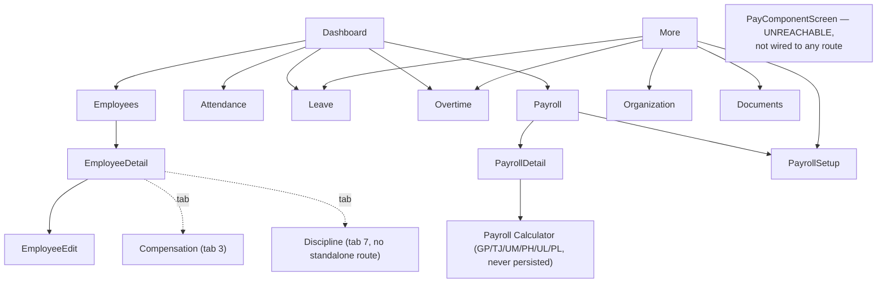

# UI_UX_FLOW_AUDIT.md — MyPayroll

- **Audit date:** 12-10-2026. Read-only (Compose source inspection only — the app was **not** launched on a device/emulator during this audit, so nothing here is `OBSERVED AT RUNTIME`; everything is `CONFIRMED FROM CODE` unless marked otherwise).
- Status legend: `WORKING` (verified reaching the DAO from the UI in source), `PARTIAL` (UI exists but is incomplete, disconnected, or non-persisted), `NOT IMPLEMENTED`, `NOT VERIFIED`.

## 1. Full route inventory (`Routes.kt` / `AppNavGraph.kt`)

| Route constant | Value | Screen | Reached from |
|---|---|---|---|
| `DASHBOARD` | `dashboard` | `DashboardScreen` | Start destination; bottom nav |
| `EMPLOYEES` | `employees` | `EmployeeScreen` | Bottom nav "Karyawan"; Dashboard quick action |
| `EMPLOYEE_DETAIL` | `employees/{employeeId}` | `EmployeeDetailScreen` | Tap employee card in `EmployeeScreen` |
| `EMPLOYEE_EDIT` | `employees/{employeeId}/edit` | `EmployeeEditScreen` | Edit icon in `EmployeeDetailScreen` app bar |
| `ATTENDANCE` | `attendance` | `AttendanceScreen` | Bottom nav "Absensi"; Dashboard quick action |
| `LEAVE` | `leave` | `LeaveScreen` | "Lainnya" menu "Cuti"; Dashboard quick action |
| `OVERTIME` | `overtime` | `OvertimeScreen` | "Lainnya" menu "Lembur"; Dashboard quick action |
| `ORGANIZATION` | `organization` | `OrganizationScreen` | "Lainnya" menu "Organisasi & Kontrak" |
| `DOCUMENTS` | `documents` | `DocumentScreen` | "Lainnya" menu "Dokumen" |
| `MORE` | `more` | `MoreScreen` | Bottom nav "Lainnya" |
| `PAYROLL` | `payroll` | `PayrollScreen` | Bottom nav "Payroll"; Dashboard quick action |
| `PAYROLL_DETAIL` | `payroll/{periodId}` | `PayrollPeriodDetailScreen` | Tap a period card in `PayrollScreen` |
| `PAYROLL_CALCULATOR` | `payroll/{periodId}/calculator` | `PayrollCalculatorScreen` | "Kalkulator Detail per Karyawan" button in `PayrollPeriodDetailScreen` |
| `PAYROLL_SETUP` | `payroll/setup` (added this session) | `PayrollSetupScreen` | "Lainnya" menu "Payroll Setup"; Settings icon in `PayrollScreen` top bar |

Reachable **without a top-level route** (embedded only):
- `EmployeeCompensationScreen` — tab index 3 inside `EmployeeDetailScreen`.
- `DisciplineScreen` — tab index 7 inside `EmployeeDetailScreen`. **No standalone entry point and not in the "Lainnya" menu** — there is no way to see disciplinary actions across all employees, only one at a time from inside that employee's detail hub.
- `PositionHistoryScreen` / `ContractMonitoringTab` — tabs inside `EmployeeDetailScreen`, reused inside `OrganizationScreen`.
- `MasterDataScreen` (generic) — instantiated inline as tabs inside `LeaveScreen` ("Jenis Cuti") and `OrganizationScreen` ("Departemen"/"Posisi"/"Jenis Kontrak").

**Unreachable from any navigation path:** `presentation/compensation/PayComponentScreen.kt` + `PayComponentViewModel.kt`. The screen and ViewModel compile and function in isolation but no `composable(...)` registers them and no menu item navigates to them. A user cannot open this screen through normal use of the app.

## 2. Per-screen status table

| Screen | Route | Data source | Loading/Empty/Error | Status |
|---|---|---|---|---|
| Dashboard | DASHBOARD | 7 real repositories via `GetDashboardSummaryUseCase`, no fabricated numbers | No explicit loading/error state — a repo failure is swallowed by `.catch { emit(DashboardSummary()) }` and silently renders all-zero stats instead of an error banner | WORKING (data real) / minor UX gap (silent failure) |
| Employee list | EMPLOYEES | `ObserveEmployeesUseCase` → real DAO | Explicit `isLoading`/empty/error states | WORKING (insert/update real); **delete button does not exist in UI** though `EmployeeViewModel.delete()` is wired and functional dead code |
| Employee detail (hub) | EMPLOYEE_DETAIL | `ObserveEmployeeProfileUseCase`, in-memory join of 6 repos, all real | Explicit loading (`current == null`); tab 8 has explicit empty state | WORKING |
| Employee edit | EMPLOYEE_EDIT | Direct `EmployeeRepository.getById`/`update` (bypasses use-case layer, still reaches DAO) | Explicit loading + error banner | WORKING |
| Attendance | ATTENDANCE | `AttendanceRepository`, upsert via `getByEmployeeAndDate` then insert/update | Explicit loading/empty/error/info states; draft rows are local-only until "Simpan" is pressed (correct, not a bug) | WORKING |
| Leave | LEAVE | `LeaveRequestRepository`; leave-type sub-tab via generic MasterData | Explicit states. **No leave balance/quota shown anywhere — deliberately omitted** (no entitlement table exists; a code comment states this is intentional rather than silently faked) | WORKING for request/approve flow; leave-balance feature NOT IMPLEMENTED (by design, not a bug) |
| Overtime | OVERTIME | `OvertimeAssignmentRepository`/`OvertimeRecordRepository` | Explicit loading/empty/error | WORKING for assign/accept/reject/record flow. `calculationAmount` is a flat `minutes × manually-typed rate` with an on-screen disclaimer that no official overtime rate exists yet — **this is the real, persisted overtime number that ultimately reaches `PayrollResultEntity`**, and it has no tiered-rate logic (see `BUSINESS_RULES_AUDIT.md`) |
| Organization (Dept/Position/ContractType/Contracts) | ORGANIZATION | 4 generic `MasterDataScreen` tabs + `ContractMonitoringTab`, all real repos | Explicit states | WORKING |
| Position history (per employee) | embedded in EMPLOYEE_DETAIL tab 1, reused in Organization | `EmployeePositionHistoryRepository`, correctly closes old row + inserts new on transfer | Explicit states | WORKING |
| Document | DOCUMENTS | `DocumentRepository`, metadata only | Explicit states; screen **self-discloses** "Hanya metadata dokumen yang disimpan - belum ada pemilih berkas (file picker) yang terhubung." | PARTIAL by design — metadata CRUD is WORKING, but no actual file is ever stored, read, or attached; this is disclosed to the user rather than hidden |
| Discipline | embedded only (EMPLOYEE_DETAIL tab 7) | `EmployeeDisciplinaryActionRepository`, real insert | Explicit states | WORKING as a record-keeping log; **PARTIAL relative to a "deduction" expectation** — no monetary field, no payroll linkage, no top-level screen to view across all employees |
| Payroll (period list) | PAYROLL | `PayrollPeriodRepository` | Explicit loading/empty + create-period dialog | WORKING |
| Payroll period detail | PAYROLL_DETAIL | `PreviewPayrollUseCase`/`ApprovePayrollUseCase`/`FinalizePayrollUseCase`/`PayrollResultRepository` | Explicit error/info messages; preview vs. saved-results branching | WORKING end-to-end for the **Path A** formula (see `BUSINESS_RULES_AUDIT.md` for what that formula actually computes — it is not the GP/TJ/UM/PH/UL/PL spec) |
| Payroll calculator (GP/TJ/UM/PH/UL/PL) | PAYROLL_CALCULATOR | `CalculatePayrollUseCase`, pre-filled this session from `PayrollSetupRepository` + real salary/attendance history | Explicit loading (`isPrefilling`)/error states | PARTIAL — calculation is correct and now pre-filled from real defaults, but the result is **never saved**; an on-screen disclaimer says so explicitly |
| Payroll Setup (new, this session) | PAYROLL_SETUP | `PayrollSetupRepository` (SharedPreferences) | Explicit loading state; save/error messages | WORKING — values save and are read back; confirmed to flow into the Payroll Calculator's defaults (see `mod-121026-1.md`) |
| PayComponent (component definitions CRUD) | **none — unreachable** | `PayComponentRepository`, real insert/update/delete | Explicit states | PARTIAL — fully functional code, zero UX reachability |
| MasterData (generic Department/Position/ContractType/LeaveType) | embedded tabs only | real repos per entity via caller-supplied lambdas | Explicit states | WORKING |

## 3. Button/action → persistence trace (spot-checked, not exhaustive)

- Employee add → `viewModel.save()` → `SaveEmployeeUseCase` → `EmployeeRepository.insert/update` → `EmployeeDao` — **real, WORKING**.
- Attendance "Simpan N Absensi" → per-draft `getByEmployeeAndDate` then insert-or-update → **real, WORKING** (correct upsert).
- Leave "Ajukan cuti" / "Tinjau" (approve/reject) → `LeaveRequestRepository.insert`/`update` → **real, WORKING**.
- Overtime "Tugaskan" / "Tanggapi" / "Catat Aktual" / "Tinjau" → `OvertimeAssignmentRepository`/`OvertimeRecordRepository` → **real, WORKING** (formula caveat noted above and in `BUSINESS_RULES_AUDIT.md`).
- Organization "Tambah kontrak" / "Akhiri Kontrak" / "Mutasi/Promosi" → respective repositories → **real, WORKING**.
- Document "Tambah dokumen" / "Hapus" → `DocumentRepository` → **real, WORKING** (metadata only, self-disclosed).
- Discipline "Tambah catatan" → `EmployeeDisciplinaryActionRepository.insert` → **real, WORKING** as a log entry; has no downstream consumer in payroll.
- Payroll "Hitung Pratinjau" → `PreviewPayrollUseCase` (in-memory) → "Setujui & Simpan" → `ApprovePayrollUseCase` → `PayrollResultRepository.insert/update` → **real, WORKING**, but computing the wrong formula per `BUSINESS_RULES_AUDIT.md`.
- Payroll Calculator "Hitung" → `CalculatePayrollUseCase` → **computes correctly, writes nothing**.
- Payroll Setup "Simpan Payroll Setup" → `PayrollSetupRepository.saveConfig` → SharedPreferences `.apply()` + in-memory `StateFlow` update → **real, WORKING**, confirmed read back by `PayrollCalculatorViewModel.selectEmployee()` on next use.
- Employee list "Hapus" — **no such button exists**; `EmployeeViewModel.delete()` is dead code.

## 4. Navigation/UX gaps

- No back-navigation issue was found anywhere — every non-bottom-nav screen examined uses either `BackScaffold` (a shared composable with a consistent back arrow) or an explicit `IconButton(onClick = onBack)`.
- No deep links exist (`CONFIRMED FROM CODE` — no `navDeepLink` usage anywhere in `AppNavGraph.kt`), and the manifest declares none either.
- No auth/login gate exists — the app opens directly to the Dashboard for anyone with the device. **Not evaluated as a defect** since no requirement for authentication was stated to this audit, but flagged as an `OPEN QUESTION` for the PRD.
- `PayrollCalculatorScreen`'s own on-screen text is the *only* place a user is told that its result is not saved — a user who skips reading that paragraph could reasonably believe clicking "Hitung" on the detailed calculator is "doing payroll," when the period's actual saved payroll comes from a completely different button ("Hitung / Hitung Ulang Pratinjau" on the period detail screen) using a different formula. This is a significant UX risk given the two-paths architecture (`ARCHITECTURE_AUDIT.md` §6), not just a cosmetic one.
- Dashboard's silent zero-state on repository failure (vs. an explicit error banner used everywhere else in the app) is inconsistent with the error-handling pattern used by every other screen examined.

## 5. Accessibility / usability notes (source-level only, not measured at runtime)

- `Icon(..., contentDescription = ...)` is consistently populated with a human-readable Indonesian label everywhere it was checked (back buttons, delete icons, FABs) — no `contentDescription = null` on an interactive icon was found in the files read for this audit.
- Material3 + dynamic color + explicit dark-theme support (`Theme.kt`) gives the app a reasonable accessibility baseline for contrast/theming out of the box; this was not independently measured (no runtime check performed).
- Money input fields across the app (`MoneyField` in the calculator, the new `RupiahMoneyField` in Payroll Setup) are plain `OutlinedTextField`s with digit-only filtering — no `KeyboardType.Number` IME hint was verified as explicitly set in every instance; `NOT VERIFIED` whether the numeric soft keyboard is forced everywhere money is entered.
